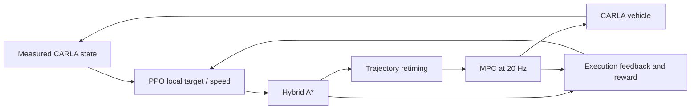

# Hierarchical autonomous driving with PPO, Hybrid A* and MPC

[中文说明](docs/README.zh-CN.md) · [Results and raw evidence](reports/native_delivery_comparison_20261105.json) · [Models and releases](https://github.com/Leo-7GOAT/Intelligent-driving-system/releases) · [Acceptance ledger](docs/research_acceptance.md)

A low-speed, known-map driving system with a complete physical feedback loop in **CARLA 0.9.15**:

**PPO decisions → local pose/speed goals → Hybrid A* → timed trajectories → MPC → vehicle controls → measured CARLA state and reward.**

The hierarchy lets learning choose a driving intention while a vehicle-aware planner and trajectory controller handle its physical execution. There is no pose teleportation during a drive. Training includes real PPO/Adam updates, checkpoint recovery, frozen observation statistics and recorded simulator acknowledgements.

## Measured advantage over direct flat PPO

On the same **24 known development conditions**, the first three closed learner seeds give:

| Learner seed | Hierarchy H success | Flat PPO B1 success | H collision/bounds | B1 collision/bounds |
|---|---:|---:|---:|---:|
| 11 | 24/24 | 10/24 | 0/24 | 13/24 |
| 22 | 23/24 | 7/24 | 0/24 | 17/24 |
| 33 | 23/24 | 5/24 | 0/24 | 17/24 |
| **Total** | **70/72 (97.2%)** | **22/72 (30.6%)** | **0/72** | **47/72** |

**The observed completion advantage is 66.7 percentage points.** These are all three closed H/B1 pairs at the delivery snapshot, including every failure. The courses share the same 48-condition TRAIN catalog, rehearsal schedule and physical calibration. Each course requested 30,720 additional physical training controls; hierarchical rollouts can overshoot the boundary. All inherited training costs remain charged. [Per-case outcomes, model hashes, raw/engine audits and ancestry](reports/native_delivery_comparison_20261105.json).


**Evidence scope:** 72 episodes repeat 24 known conditions across three learners; they are not 72 unique final cases. Seed 22 H was recovered after an interruption and retains an unknown ancestral tail. B1 seeds 11 and 22 pass the registered basic gate; seed 33 fails with 2/4 successes and 2 unsafe episodes. All three are retained in the table. The two gate-qualified pairs alone are H 47/48 versus B1 17/48 (+62.5 points), still on known development conditions. Adequate complex-task convergence and equal historical development cost are not established. The saved Adam rates are H 3e-5 versus B1 3e-6; rollout cadence and update counts also differ ([actual recipe audit](reports/native_delivery_actual_learning_rates_20261105.json)). This is a descriptive engineering comparison, not the required five-seed independent confirmation or a PPO-only causal gain.

Across the three paired learners, the per-class success counts are **24/24 versus 10/24 on curves**, **23/24 versus 6/24 with static vehicles**, and **23/24 versus 6/24 with crossing walkers** (H versus B1). Each class repeats eight known geometries/conditions across three learners.

## What the hierarchy contributes

- **A structured learning problem.** PPO selects local targets at 2 Hz; it does not have to generate 20 Hz steering and acceleration directly as B1 does.
- **Physically executable motion.** Hybrid A* accounts for vehicle geometry and measured steering; trajectory retiming respects speed and steering-rate limits before MPC tracking.
- **Closed-loop correction.** The controller follows actual CARLA measurements. Planning, tracking, intervention and execution-failure information is exposed to the high-level policy and logged.
- **Inspectability and recovery.** A failed target, failed plan, tracking error or actuator mismatch can be traced separately. Saved models include optimizer state, normalization and RNG evidence.

These mechanisms explain the architecture; the table establishes its observed development advantage over this flat baseline. They do not establish that every module improves every case. In particular, warm initialized H before the new PPO courses already scores 72/72, compared with 70/72 afterwards ([paired before/after evidence](reports/native_delivery_warm_initialization_comparison_20261105.json)). H0 completes 72/72 in the same three paired learners; the current added failure-feedback term does not improve completion, and a strong rule B3 reaches 54/54 on an earlier known-condition inventory. **Additional PPO-specific benefit over B3 remains unproven.** [H/H0 seed11](reports/native_independent_outcome_seed11_pair_complete_20261104.json), [seed22](reports/native_independent_seed22_pair_complete_20261105.json), [strong B3 comparison](reports/native_shared_lowlevel_H_H0_B3_complete_20261104.json).



## Actual CARLA recordings

Both clips use trained **seed 11**, the same registered geometry/hazard/calibration and **original known case 12**, with zero PPO updates during recording.

| Method | Actual outcome | Physical controls | RGB video |
|---|---|---:|---|
| Hierarchy H | Success | 355 | [Watch H](https://github.com/Leo-7GOAT/Intelligent-driving-system/releases/download/v0.5.0-dev.20261105-hierarchical-delivery/seed11_H_case12_actual_RGB.mp4) |
| Flat PPO B1 | Collision | 125 | [Watch B1](https://github.com/Leo-7GOAT/Intelligent-driving-system/releases/download/v0.5.0-dev.20261105-hierarchical-delivery/seed11_B1_case12_actual_RGB.mp4) |

These are actual 640×360 CARLA RGB frames at 20 Hz. The case was selected from known outcomes before recording; both new recordings are retained and decoded after anonymous download. It is an illustration, not a new independent final test. [Registration](reports/native_delivery_same_case_camera_registration_20261105.json), [H download/decode](reports/native_delivery_H_RGB_public_verification_20261105.json), [B1 download/decode](reports/native_delivery_B1_RGB_public_verification_20261105.json).

## Install and verify

Use **Python 3.11** for the learning stack and the existing **CARLA 0.9.15** installation with its separate compatible Python 3.7 client. Do not recreate an existing working environment.

```powershell
python -m venv .venv
.\.venv\Scripts\python.exe -m pip install -r requirements.lock.txt
.\.venv\Scripts\python.exe -m pytest -q -m "not carla"
```

The delivered source and tooling passed **1,483 CPU tests**, with 25 skipped and 4 CARLA tests deselected ([executed PR CI](https://github.com/Leo-7GOAT/Intelligent-driving-system/actions/runs/41967786740)). The implementation and README were merged through [PR9](https://github.com/Leo-7GOAT/Intelligent-driving-system/pull/9) and the gate-disclosure correction [PR10](https://github.com/Leo-7GOAT/Intelligent-driving-system/pull/10). CPU checks cover dynamics, planning, MPC, PPO updates and recovery; live CARLA evidence is separate. [Native setup and execution](docs/CARLA_bridge.md), [method and module layout](docs/design.md).

All five flat fixed-window courses are now closed: **38/120 repeated known episodes**, with 78 collision/bounds episodes and **2/5 basic gates passed**. Seeds 44/55 are retained as unmatched rows; the hierarchy table uses all three available matched learners. These 120 episodes repeat 24 conditions. [Complete flat cohort](reports/native_delivery_five_flat_windows_complete_20261105.json).

## Download models and reproduce evidence

The [2026-11-05 delivery prerelease](https://github.com/Leo-7GOAT/Intelligent-driving-system/releases/tag/v0.5.0-dev.20261105-hierarchical-delivery) contains frozen models, normalization, configuration, source, complete endpoint traces and training evidence. It is a **development release**, not a research acceptance certificate. The [full asset manifest](protocols/public_native_delivery_all_assets_20261105.json) lists all 30 ZIP capsules and two direct videos with exact SHA256 values. All 30 were anonymously downloaded and rebuilt in a fresh checkout on the same host using the installed environment: **378 measured-start actions,4,732 static H decisions,136,592 evaluation controls and 325,712 new training-segment controls** were verified; all 26 endpoint figures and the overall comparison match. [Executed public reproduction](reports/native_delivery_all_public_reproduction_20261105.json).

For each endpoint capsule, in a fresh checkout and fresh output directory:

```powershell
.\.venv\Scripts\python.exe scripts/reproduce_native_asset.py --archive PATH_TO_DOWNLOADED_ENDPOINT.zip --sha256 PUBLISHED_SHA256 --output runs/my_fresh_rebuild
```

This verifies every packaged file, restores the saved policy, reconstructs measured-start inference and raw controls, and rebuilds the trajectory figure. It performs zero new driving or learning. To rebuild the comparison after extracting the endpoints under one directory:

```powershell
.\.venv\Scripts\python.exe scripts/build_native_delivery_comparison.py --archive EXTRACTED_BATCH_PARENT --output runs/comparison.json --figure runs/comparison.png
```

Training archives also include exact new training traces, reset/engine streams, checkpoint/Adam/RMS proofs and inherited-cost metadata. Historical ancestor traces are not duplicated. Simulator binaries, installed environments and credentials are excluded. Earlier [verified model releases](https://github.com/Leo-7GOAT/Intelligent-driving-system/releases/tag/v0.4.0-dev.20261104-outcome-shared-control) and actual camera evidence in the earlier release catalog retain their original versions and outcomes.

## Delivery status and research limits

The user imposed a final three-hour delivery window on 2026-11-05. All 37 normally completed native job lifecycles are closed, and the task owns no remaining native worker or CARLA server. Three H/H0 pairs and five flat fixed-window courses are complete. Work closes with the available measured evidence; unstarted conditional-feedback, deployment-frequency/safety and new fixed-reference control studies are explicitly **deferred with zero native results**, not presented as completed experiments. The native Grid baseline also lacks its planned complete run. [Delivery and reproduction receipt](reports/native_final_delivery_20261105.json).

The original research target remains: five independent trained learners, a sufficiently trained fair flat baseline, at least 120 **new unique paired final conditions**, per-class safety/completion gates, and a paired confidence bound supporting the required advantage. Those final conditions have not been generated or inspected. PPO-specific benefit and full collaboration/control ablations remain incomplete. **Full research acceptance is UNMET.** The project does not establish real-time, high-speed, production or real-vehicle capability.

[Failure analysis](docs/failure_analysis.md) · [Feedback diagnosis](docs/full_moving_failure_diagnosis.md) · [Experiment history](docs/README.development-history.md) · [Evidence-bounded CV description](docs/resume_project.md) · [MIT license](LICENSE) · [Third-party notices](docs/THIRD_PARTY_NOTICES.md)
