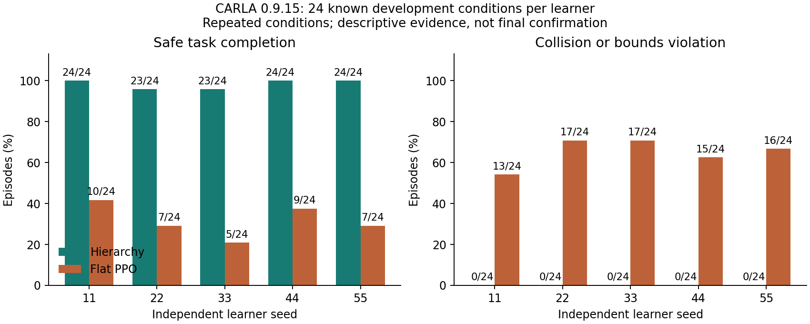
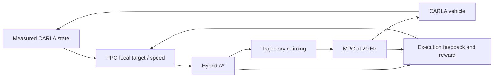

# Hierarchical autonomous driving with PPO, Hybrid A* and MPC

[中文说明](docs/README.zh-CN.md) · [Results and raw evidence](reports/native_five_pair_comparison_20261105.json) · [Models and releases](https://github.com/Leo-7GOAT/Intelligent-driving-system/releases) · [Acceptance ledger](docs/research_acceptance.md)

A low-speed, known-map driving system with a complete physical feedback loop in **CARLA 0.9.15**:

**PPO decisions → local pose/speed goals → Hybrid A* → timed trajectories → MPC → vehicle controls → measured CARLA state and reward.**

The hierarchy lets learning choose a driving intention while a vehicle-aware planner and trajectory controller handle its physical execution. There is no pose teleportation during a drive. Training includes real PPO/Adam updates, checkpoint recovery, frozen observation statistics and recorded simulator acknowledgements.

## Measured advantage over direct flat PPO

On the same **24 known development conditions**, all five registered closed learner seeds give:

| Learner seed | Hierarchy H success | Flat PPO B1 success | H collision/bounds | B1 collision/bounds |
|---|---:|---:|---:|---:|
| 11 | 24/24 | 10/24 | 0/24 | 13/24 |
| 22 | 23/24 | 7/24 | 0/24 | 17/24 |
| 33 | 23/24 | 5/24 | 0/24 | 17/24 |
| 44 | 24/24 | 9/24 | 0/24 | 15/24 |
| 55 | 24/24 | 7/24 | 0/24 | 16/24 |
| **Total** | **118/120 (98.3%)** | **38/120 (31.7%)** | **0/120** | **78/120** |

**The observed completion advantage is 66.7 percentage points.** These are all five registered H/B1 pairs, including every failure. The courses share the same 48-condition TRAIN catalog, rehearsal schedule and physical calibration. Each course requested 30,720 additional physical training controls; hierarchical rollouts can overshoot the boundary. All inherited training costs remain charged. [Per-case outcomes, model hashes, raw/engine audits and ancestry](reports/native_five_pair_comparison_20261105.json).



**Evidence scope:** 120 episodes per method repeat the same 24 known conditions across five trained learners. Seed 22 H retains an interruption and an unknown ancestral tail. Only B1 seeds 11/22 pass the registered basic gate; seeds 33/44/55 fail, and every seed remains in the table. Adequate complex-task convergence and equal historical development cost are unestablished. Saved Adam rates are H 3e-5 versus B1 3e-6; rollout cadence and update counts differ ([recipe audit](reports/native_delivery_actual_learning_rates_20261105.json)).

The exploratory paired seed-level mean gap is **66.7 percentage points**, with a 95% Student t interval **[58.49, 74.85] points** and exact two-sided sign-flip **p=0.0625**. There are five seed replications, not 120 independent conditions. Three seed outcomes were already observed when the remaining-pair analysis plan was frozen; these unadjusted statistics do not establish confirmatory significance or satisfy the final-test gate. [All three contrasts and assumptions](reports/native_five_pair_comparison_20261105.json), [dated analysis plan](protocols/native_remaining_pairs_analysis_20261105.json).

## What the hierarchy contributes

- **A structured learning problem.** PPO selects local targets at 2 Hz; it does not have to generate 20 Hz steering and acceleration directly as B1 does.
- **Physically executable motion.** Hybrid A* accounts for vehicle geometry and measured steering; trajectory retiming respects speed and steering-rate limits before MPC tracking.
- **Closed-loop correction.** The controller follows actual CARLA measurements. Planning, tracking, intervention and execution-failure information is exposed to the high-level policy and logged.
- **Inspectability and recovery.** A failed target, failed plan, tracking error or actuator mismatch can be traced separately. Saved models include optimizer state, normalization and RNG evidence.

These mechanisms explain the architecture and its observed development advantage over this flat baseline. Warm initialized H before the new PPO courses already scores **120/120**, compared with **118/120** afterwards. H0 scores **120/120** across the same five learners. Added PPO and the current failure-feedback term therefore show no completion gain in this inventory. Strong rule B3 reaches 54/54 on an earlier known-condition inventory; **PPO-specific benefit over B3 remains unproven**. [Full before/after and H/H0 results](reports/native_five_pair_comparison_20261105.json), [strong B3 evidence](reports/native_shared_lowlevel_H_H0_B3_complete_20261104.json).



## Actual CARLA recordings

Both clips use trained **seed 11**, the same registered geometry/hazard/calibration and **original known case 12**, with zero PPO updates during recording.

| Method | Actual outcome | Physical controls | RGB video |
|---|---|---:|---|
| Hierarchy H | Success | 355 | [Watch H](https://github.com/Leo-7GOAT/Intelligent-driving-system/releases/download/v0.5.0-dev.20261105-hierarchical-delivery/seed11_H_case12_actual_RGB.mp4) |
| Flat PPO B1 | Collision | 125 | [Watch B1](https://github.com/Leo-7GOAT/Intelligent-driving-system/releases/download/v0.5.0-dev.20261105-hierarchical-delivery/seed11_B1_case12_actual_RGB.mp4) |

These are actual 640×360 CARLA RGB frames at 20 Hz. The case was selected from known outcomes before recording; both new recordings are retained and decoded after anonymous download. It is an illustration, not a new independent final test. [Registration](reports/native_delivery_same_case_camera_registration_20261105.json), [H download/decode](reports/native_delivery_H_RGB_public_verification_20261105.json), [B1 download/decode](reports/native_delivery_B1_RGB_public_verification_20261105.json).

## Install and verify

Use **Python 3.11** for the learning stack and the existing **CARLA 0.9.15** installation with its separate compatible Python 3.7 client. Do not recreate an existing working environment.

```powershell
python -m venv .venv
.\.venv\Scripts\python.exe -m pip install -r requirements.lock.txt
.\.venv\Scripts\python.exe -m pytest -q -m "not carla"
```

The delivered source and tooling passed **1,497 CPU tests**, with 25 skipped and 4 CARLA tests deselected ([executed PR CI](https://github.com/Leo-7GOAT/Intelligent-driving-system/actions/runs/41981121815)). The continuation tooling and five-seed analysis were merged through [PR12](https://github.com/Leo-7GOAT/Intelligent-driving-system/pull/12) and [PR13](https://github.com/Leo-7GOAT/Intelligent-driving-system/pull/13). CPU checks cover dynamics, planning, MPC, PPO updates and recovery; live CARLA evidence is separate. [Native setup and execution](docs/CARLA_bridge.md), [method and module layout](docs/design.md).

All five flat fixed-window courses are now closed: **38/120 repeated known episodes**, with 78 collision/bounds episodes and **2/5 basic gates passed**. All five now have closed matched H endpoints. These 120 episodes repeat 24 conditions. [Complete flat cohort](reports/native_delivery_five_flat_windows_complete_20261105.json).

## Download models and reproduce evidence

The [five-pair development supplement](https://github.com/Leo-7GOAT/Intelligent-driving-system/releases/tag/v0.6.0-dev.20261105-five-paired-learners) adds all **10** previously missing phase capsules: four real training courses and six known24 evaluations. All ten were anonymously downloaded and rebuilt in a fresh checkout on the same host with the installed environment; the complete five-seed comparison JSON and figure match the local reconstruction. [Executed supplement reproduction](reports/native_five_pair_public_reproduction_20261105.json). All 18 supplement assets are published; the eight metadata assets were also anonymously downloaded and hash-checked ([final asset receipt](reports/native_five_pair_public_metadata_verification_20261105.json)).

The [full manifest](protocols/public_native_five_pair_assets_20261105.json) links these ten capsules and all **30** retained capsules plus two direct videos in the [parent release](https://github.com/Leo-7GOAT/Intelligent-driving-system/releases/tag/v0.5.0-dev.20261105-hierarchical-delivery). Parent reproduction verified 378 measured-start actions, 4,732 static H decisions, 136,592 evaluation controls and 325,712 new training-segment controls. Those are dated parent counts, not the new combined total. [Parent reproduction receipt](reports/native_delivery_all_public_reproduction_20261105.json).

For each endpoint capsule, in a fresh checkout and fresh output directory:

```powershell
.\.venv\Scripts\python.exe scripts/reproduce_native_asset.py --archive PATH_TO_DOWNLOADED_ENDPOINT.zip --sha256 PUBLISHED_SHA256 --output runs/my_fresh_rebuild
```

This verifies every packaged file, restores the saved policy, reconstructs measured-start inference and raw controls, and rebuilds the trajectory figure. It performs zero new driving or learning. To rebuild the comparison after extracting the endpoints under one directory:

```powershell
.\.venv\Scripts\python.exe -m scripts.build_native_delivery_comparison --archive EXTRACTED_BATCH_PARENT --output runs/comparison.json --figure runs/comparison.png
```

Training archives also include exact new training traces, reset/engine streams, checkpoint/Adam/RMS proofs and inherited-cost metadata. Historical ancestor traces are not duplicated. Simulator binaries, installed environments and credentials are excluded. Earlier [verified model releases](https://github.com/Leo-7GOAT/Intelligent-driving-system/releases/tag/v0.4.0-dev.20261104-outcome-shared-control) and actual camera evidence in the earlier release catalog retain their original versions and outcomes.

## Delivery status and research limits

Both remaining registered seed44/55 H/H0 pairs are complete under their original budgets. All five pairs and five flat fixed-window courses are closed; all ten new native job lifecycles have normal exit and owned server cleanup receipts. [Completion ledger](reports/native_five_pair_complete_20261105.json), [47 verified native lifecycles](reports/native_five_pair_owned_lifecycle_closed_20261105.json). Conditional-feedback, deployment-frequency/shared-safety, new fixed-reference and complete native Grid studies remain deferred with zero new native results in this supplement.

The five-learner count is now satisfied on this known catalog. Remaining original acceptance gates include a sufficiently trained fair flat baseline, at least 120 **new unique paired final conditions**, per-class safety/completion gates, and a paired confidence bound supporting the required advantage. Those final conditions have not been generated or inspected. PPO-specific benefit and full collaboration/control ablations remain incomplete. **Full research acceptance is UNMET.** The project does not establish real-time, high-speed, production or real-vehicle capability.

[Failure analysis](docs/failure_analysis.md) · [Feedback diagnosis](docs/full_moving_failure_diagnosis.md) · [Experiment history](docs/README.development-history.md) · [Evidence-bounded CV description](docs/resume_project.md) · [MIT license](LICENSE) · [Third-party notices](docs/THIRD_PARTY_NOTICES.md)
