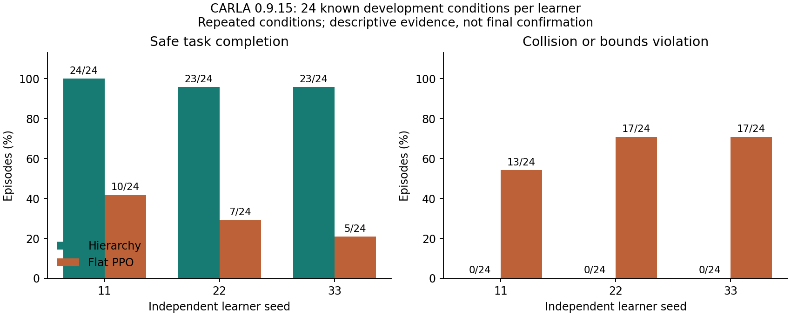

# 分层自动驾驶：PPO、Hybrid A* 与 MPC

[English](../README.md) · [逐条件结果与模型哈希](../reports/native_delivery_comparison_20261105.json) · [GitHub 模型发布](https://github.com/Leo-7GOAT/Intelligent-driving-system/releases/tag/v0.5.0-dev.20261105-hierarchical-delivery)

本项目实现真实 CARLA 0.9.15 闭环：**PPO 高层决策 → 局部位姿/速度目标 → Hybrid A* → 时间轨迹 → MPC → 车辆执行 → 实测状态与奖励反馈**。驾驶过程中使用车辆物理控制，没有通过修改位姿完成任务。

## 分层相对 flat PPO 的实测优势

三组已闭合学习种子，在相同的 24 个已知开发条件上完整评估：

| 种子 | 分层 H 成功 | 直接控制 B1 成功 | H 碰撞/越界 | B1 碰撞/越界 |
|---|---:|---:|---:|---:|
| 11 | 24/24 | 10/24 | 0/24 | 13/24 |
| 22 | 23/24 | 7/24 | 0/24 | 17/24 |
| 33 | 23/24 | 5/24 | 0/24 | 17/24 |
| **累计** | **70/72（97.2%）** | **22/72（30.6%）** | **0/72** | **47/72** |

分层方案的观察完成率高出 **66.7 个百分点**，且这三组中未出现碰撞或越界。全部成功与失败均保留。每个学习课程预设新增 30,720 个真实物理控制步，分层 rollout 允许到边界后有限超额；历史训练、教师与恢复成本另行计入。[完整证据](../reports/native_delivery_comparison_20261105.json)。

**范围必须明确：**72 次评估是三个学习器重复同一批 24 个开发条件，不是 72 个独立新场景。seed22 H 经中断恢复，保留可读丢弃尾部和未知未落盘尾部；B1 虽通过预登记基础道路筛查，但复杂任务充分收敛及历史总成本相等尚未建立。这是开发证据，尚不能替代五种子和最终独立测试。

## 为什么采用分层

- **降低高层学习负担：**PPO 以 2 Hz 选择局部目标与速度，把 20 Hz 的连续执行交给控制器；B1 则直接输出加速度和转向。
- **显式处理物理可执行性：**Hybrid A* 考虑车辆几何与实测转向，时间重定时约束速度和转向变化，MPC 跟踪可执行参考。
- **形成执行反馈闭环：**规划失败、参考执行与跟踪信息进入策略观测和训练记录，能定位“目标选择—规划—控制—执行”的具体问题。
- **保留可检查的工程证据：**模型、Adam、归一化、RNG、控制帧与 CARLA 回执均有记录，支持恢复与离线复现。

分层整体优于该 flat 基线，不等于新增 PPO 或反馈项单独有效。零 PPO 初始化 H 已有较高表现，当前 H0 消融未显示新增反馈完成率收益；较早同低层强规则 B3 在已知条件上为 54/54。**相对强 B3 的 PPO 独立增益仍未证实。**[消融与 B3 证据](../reports/native_shared_lowlevel_H_H0_B3_complete_20261104.json)。

## 运行与复现

学习栈使用 Python 3.11；CARLA 0.9.15 服务端使用已有安装及独立兼容 Python 3.7 客户端，不重建已有环境。安装、CPU 测试与公开模型复现命令见 [根 README](../README.md)。此前源码 GitHub CI 实际通过 1,473 项 CPU 测试，25 项跳过、4 项 CARLA 测试排除；交付工具的最终检查见发布回执。

[本次开发发布](https://github.com/Leo-7GOAT/Intelligent-driving-system/releases/tag/v0.5.0-dev.20261105-hierarchical-delivery)提供模型、归一化、协议、冻结源码、全量端点评估及训练证据包。下载后按公开 SHA256 校验，使用 `scripts/reproduce_native_asset.py` 在新目录重建原始控制审计、策略推理与结果图；该流程不新增驾驶或学习。[CARLA 说明](CARLA_bridge.md)。

## 最终交付状态

按用户 2026-11-05 的最后三小时期限收尾。未启动的条件反馈、部署频率/共同安全制动、新版固定参考控制器研究明确延期，原生结果为零；Grid 原生完整对照也未完成。既有准备材料与失败均保留，不计为已通过实验。[交付回执](../reports/native_final_delivery_20261105.json)。

原研究目标仍是：五个独立训练学习器、充分训练且公平的 flat 基线、至少 120 个新且唯一的配对最终条件、各核心类别完成率和安全门槛、优势的配对置信下界，以及独立 PPO 和协同价值。最终 120 条件尚未生成或查看，完整控制与消融证据尚不齐备，**整体研究验收仍未达到**。不宣称实时、高速、量产或实车能力。

[验收台账](research_acceptance.md) · [机制诊断](full_moving_failure_diagnosis.md) · [简历表述](resume_project.md) · [历史记录](README.development-history.md)
