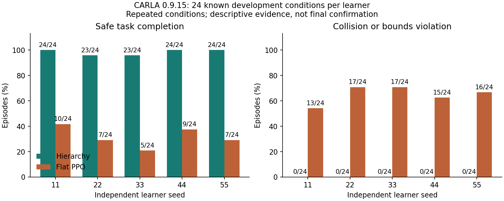

# 分层自动驾驶：PPO、Hybrid A* 与 MPC

[English](../README.md) · [逐条件结果与模型哈希](../reports/native_five_pair_comparison_20261105.json) · [GitHub 模型发布](https://github.com/Leo-7GOAT/Intelligent-driving-system/releases/tag/v0.6.0-dev.20261105-five-paired-learners)

本项目实现真实 CARLA 0.9.15 闭环：**PPO 高层决策 → 局部位姿/速度目标 → Hybrid A* → 时间轨迹 → MPC → 车辆执行 → 实测状态与奖励反馈**。驾驶过程中使用车辆物理控制，没有通过修改位姿完成任务。

## 分层相对 flat PPO 的实测优势

五组登记学习种子均已闭合，在相同的 24 个已知开发条件上完整评估：

| 种子 | 分层 H 成功 | 直接控制 B1 成功 | H 碰撞/越界 | B1 碰撞/越界 |
|---|---:|---:|---:|---:|
| 11 | 24/24 | 10/24 | 0/24 | 13/24 |
| 22 | 23/24 | 7/24 | 0/24 | 17/24 |
| 33 | 23/24 | 5/24 | 0/24 | 17/24 |
| 44 | 24/24 | 9/24 | 0/24 | 15/24 |
| 55 | 24/24 | 7/24 | 0/24 | 16/24 |
| **累计** | **118/120（98.3%）** | **38/120（31.7%）** | **0/120** | **78/120** |

分层整体的观察完成率优势为 **66.7 个百分点**，全部五组及其失败均保留。每个课程请求新增30,720个物理控制步，允许有限rollout超额；共用48条件TRAIN目录、重访顺序和物理标定，历史教师与恢复成本保留计入。

**范围：**每方法120次是五个学习器重复同24个已知条件，不能当作120个新最终条件。seed22 H保留中断恢复及未知祖先尾部。B1仅seed11/22通过基础门槛，其余三组失败且完整保留；充分收敛和历史总成本相等未建立。Adam实际学习率H3e-5、B13e-6，更新节奏不同。[配方核验](../reports/native_delivery_actual_learning_rates_20261105.json)。

以五个种子为重复单位，探索性配对均差为66.7个百分点，95% t区间为 **[58.49, 74.85]**，双侧精确符号翻转p=0.0625。前三组已被观察，分析不是独立确认性预注册；统计未校正多重比较，不能替代最终测试。[完整逐条件结果与统计假设](../reports/native_five_pair_comparison_20261105.json)。

## 为什么采用分层

- **降低高层学习负担：**PPO 以 2 Hz 选择局部目标与速度，把 20 Hz 的连续执行交给控制器；B1 则直接输出加速度和转向。
- **显式处理物理可执行性：**Hybrid A* 考虑车辆几何与实测转向，时间重定时约束速度和转向变化，MPC 跟踪可执行参考。
- **形成执行反馈闭环：**规划失败、参考执行与跟踪信息进入策略观测和训练记录，能定位“目标选择—规划—控制—执行”的具体问题。
- **保留可检查的工程证据：**模型、Adam、归一化、RNG、控制帧与 CARLA 回执均有记录，支持恢复与离线复现。

本轮PPO前的热启动H为 **120/120**，训练后 **118/120**；H0为 **120/120**，没有显示新增PPO或当前失败反馈项的完成率收益。较早强规则B3为54/54，**相对B3的PPO独立增益仍未证实**。[五组完整消融](../reports/native_five_pair_comparison_20261105.json)、[B3证据](../reports/native_shared_lowlevel_H_H0_B3_complete_20261104.json)。

## 同一场景的真实录像

两段均使用已训练的seed11、原始已知case12，几何、障碍和标定相同，录制期间零PPO更新。分层H成功，实际355个控制步：[H录像](https://github.com/Leo-7GOAT/Intelligent-driving-system/releases/download/v0.5.0-dev.20261105-hierarchical-delivery/seed11_H_case12_actual_RGB.mp4)；flat B1碰撞，实际125步：[B1录像](https://github.com/Leo-7GOAT/Intelligent-driving-system/releases/download/v0.5.0-dev.20261105-hierarchical-delivery/seed11_B1_case12_actual_RGB.mp4)。均为真实640×360、20Hz的CARLA RGB帧，已匿名下载并解码核验。这是根据既有结果预选的示例，全部新录制结果均保留，不计入独立最终测试。[登记与证据](../reports/native_delivery_same_case_camera_registration_20261105.json)。

## 运行与复现

学习栈使用 Python 3.11；CARLA 0.9.15 服务端使用已有安装及独立兼容 Python 3.7 客户端，不重建已有环境。安装、CPU 测试与公开模型复现命令见 [根 README](../README.md)。源码及工具的 [GitHub CI](https://github.com/Leo-7GOAT/Intelligent-driving-system/actions/runs/41981121815) 实际通过 **1,497 项 CPU 测试**，25 项跳过、4 项 CARLA 测试排除；补跑与五组分析工具已通过 [PR12](https://github.com/Leo-7GOAT/Intelligent-driving-system/pull/12) 和 [PR13](https://github.com/Leo-7GOAT/Intelligent-driving-system/pull/13) 合并主分支。

[此前三组开发发布](https://github.com/Leo-7GOAT/Intelligent-driving-system/releases/tag/v0.5.0-dev.20261105-hierarchical-delivery)提供模型、归一化、协议、冻结源码、全量端点评估及训练证据包。下载后按公开 SHA256 校验，使用 `scripts/reproduce_native_asset.py` 在新目录重建原始控制审计、策略推理与结果图；该流程不新增驾驶或学习。[CARLA 说明](CARLA_bridge.md)。

五个flat固定训练窗口均闭合，known24累计38/120，78次碰撞/越界，只有2/5通过基础筛查。120次是同24条件的重复；五组现在均有闭合的配对H结果。[五种子完整结果](../reports/native_delivery_five_flat_windows_complete_20261105.json)。

此前v0.5的30个ZIP证据包及两段直接视频均已公开。该版本全部ZIP已匿名下载，在同一主机的新checkout、复用已安装环境完成复现：378个起点策略动作、4732个静态H决策、136592个评估控制及325712个新增训练段控制通过；26张端点图和整体对照图一致。[完整公开复现](../reports/native_delivery_all_public_reproduction_20261105.json)。

## 本次补齐状态

seed44/55四段训练与六次评估已按原预算全部完成，十个新增原生作业正常闭合并清理自身服务器；五组H/H0与五组flat固定窗口均闭合。[完成回执](../reports/native_five_pair_complete_20261105.json)。

[五组补充发布](https://github.com/Leo-7GOAT/Intelligent-driving-system/releases/tag/v0.6.0-dev.20261105-five-paired-learners)的10个新增证据包均已匿名下载，在同主机新checkout复现；完整五组比较JSON语义一致、主图字节一致。[执行证明](../reports/native_five_pair_public_reproduction_20261105.json)。[资产总清单](../protocols/public_native_five_pair_assets_20261105.json)同时保留此前30个包与两段视频。

条件反馈、部署频率/共同安全制动、新固定参考及完整原生Grid研究继续延期，本次未新增其原生结果。

已完成同已知目录上的五个独立训练学习器数量要求。原目标仍待完成的门槛包括：充分训练且公平的 flat 基线、至少120个新且唯一的配对最终条件、各核心类别完成率和安全门槛、优势的配对置信下界，以及独立PPO和协同价值。最终 120 条件尚未生成或查看，完整控制与消融证据尚不齐备，**整体研究验收仍未达到**。不宣称实时、高速、量产或实车能力。

[验收台账](research_acceptance.md) · [机制诊断](full_moving_failure_diagnosis.md) · [简历表述](resume_project.md) · [历史记录](README.development-history.md)
