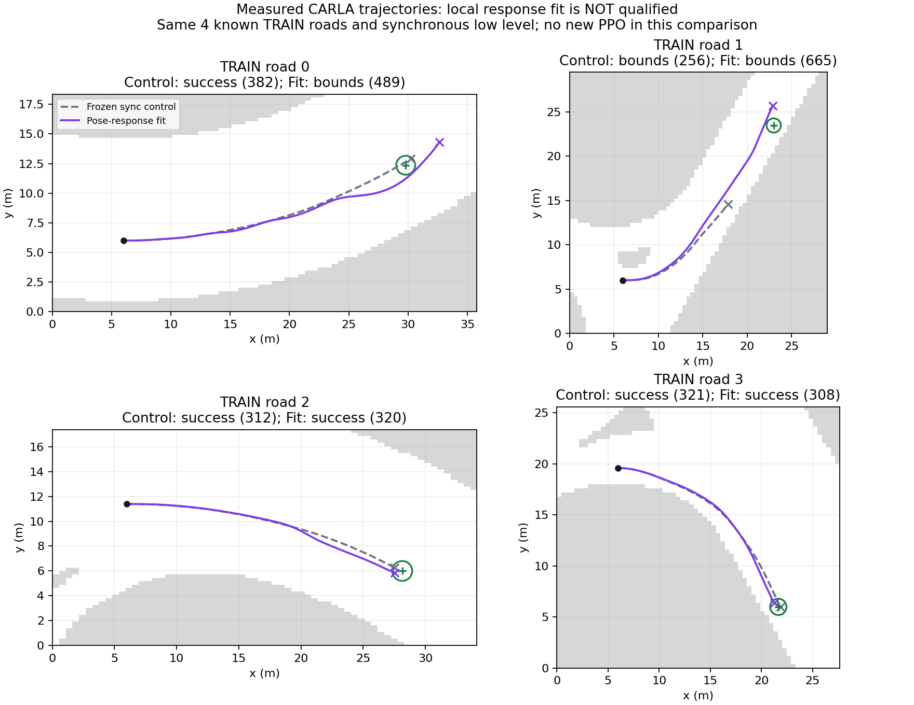

# Flat-policy feedback diagnosis and rejected deployment

The native B1 basic driving qualification remains **unmet**. This development
experiment adds explicit counterfactual supervision; it does not establish a
PPO benefit, a healthy five-seed baseline or a final-test result.

On all four original TRAIN roads, the fixed replay policy has small pointwise
teacher steering errors, about 0.004–0.005 radians. However, at 30 prospectively
selected measured states, hypothetical lateral displacements of ±0.1 m and yaw
changes of ±0.02 rad reveal substantially weaker correction than the held-reference
MPC. Median absolute policy/MPC gain ratios are 0.075 and 0.140 respectively.
Thirteen lateral and four yaw responses have opposite signs. All 1,297 measured
reference-prefix commands were reconstructed before interpreting these queries.
These are local input perturbations, not executed demonstrations or a stability
proof. MPC reference, previous command and time remain fixed within each query.

A ten-coefficient steering residual using existing candidate geometry fails its
offline response screen and is rejected without native driving. Its optional
policy implementation is retained for reproduction; it is not installed in the
subsequent model. A separate fit updates the original actor network to match
one-sided pose responses while preserving its old outputs on 3,467 measured
TRAIN inputs. Those anchor targets are self-distillation, not new teacher actions.
Only query states with matching current and previous engine acknowledgements
are eligible. The original architecture, critic, road encoder, Gaussian log_std,
PPO optimizer, counters and normalization remain fixed.

The first 512 auxiliary Adam steps fail the unchanged response screen. A declared
1,024-step continuation passes. The first auxiliary optimizer was not saved, so
the continuation explicitly restarts auxiliary Adam; its saved optimizer has
1,024 steps in every fitted parameter state. The retained PPO optimizer is
unchanged throughout. Total new auxiliary updates are 1,536, plus one rejected
closed-form ridge solve. There are zero new PPO updates in either offline fit.

| Check | Initial response error | Final response error |
|---|---:|---:|
| Lateral pose response, normalized steering RMS | 0.05812 | 0.02602 |
| Yaw pose response, normalized steering RMS | 0.05257 | 0.02030 |

Teacher steering RMS remains below 0.01 rad on each basic road. Acceleration
output RMS displacement at the anchor states is 0.00461 in normalized units.
These are TRAIN diagnostics; no independent generalization claim follows.

The resulting frozen model is deployed on the same four TRAIN roads with the
validated `batch_sync_v1` interface, identical gains, goals, reward, observations
and direct network architecture. No teacher runs in this deployment.

| Case | Frozen sync control | Pose-response fit |
|---|---|---|
| 0 | Success, 382 controls | Bounds, 489 controls |
| 1 | Bounds, 256 controls | Bounds, 665 controls |
| 2 | Success, 312 controls | Success, 320 controls |
| 3 | Success, 321 controls | Success, 308 controls |

The fit is **not promoted**: 2/4 success and two bounds failures do not pass the
existing ≥3/4 success AND zero collision/bounds gate. All 1,782 deployment controls
and four measured-start policy actions are audited; engine acknowledgements match
on every control. The lifecycle exits normally and its owned empty server stops.
The original outcomes and failed checkpoints are retained. New raw inputs and
models remain local at this snapshot.



An additional input-reflection diagnostic finds large left/right inconsistencies
in the fixed replay network. Its observation transform is checked against rebuilt
geometry, including asymmetric road cells, obstacle vertices, dynamic actors,
candidate slot permutations and history, and is exactly involutive. Mirrored
inputs are hypothetical and outside the original measured distribution; their
output errors are much larger. This does not justify adopting a mirrored policy
or claiming a driving improvement. The raw-result report is
[reflection sensitivity](../reports/native_B1_reflection_diagnostic_20261101.json).

A separately registered basic-course PPO continuation starts from this fixed
fit with `batch_sync_v1` held constant throughout learning. Its budget is 10,240
new physical training controls, with one final endpoint and all four original
TRAIN-road evaluations. It keeps the trained Gaussian exploration parameters
and adds no runtime teacher or supervised updates. It is an explicitly warm-started
development course; the failed deployment is not used to claim qualification.
The job `20261101T094700825994Z_native_B1_feedback_PPO` is now complete: 10,240 new
physical training controls, 320 actual Adam steps, 80 PPO epoch updates, with
unchanged observation RMS. All 35 saved Adam parameter states advance by 320;
both actor and critic change. The endpoint remains 2/4 with two bounds failures
(cases 0/1 at 438/634 controls; cases 2/3 succeed at 311/310). The 11,933 training
and evaluation controls have matching engine acknowledgements. All 1,693 endpoint
actions are reconstructed bit-exactly from measured history, as are all 1,782
actions from the preceding offline-fit deployment. The owned server stops normally.
[Actual PPO proof](../reports/native_B1_feedback_PPO_20261101.json),
[full PPO endpoint inference](../reports/native_B1_feedback_PPO_whole_sequence_20261101.json),
[preceding fit endpoint inference](../reports/native_B1_feedback_contrast_whole_sequence_20261101.json).

A subsequent reflection-augmentation experiment uses 3,424 old teacher TRAIN
rows whose current and previous engine controls match the requests, plus 3,424
virtual reflected rows. It also retains the pose-response supervision on original
and reflected inputs. Mirrored labels are hypothetical, not additional CARLA
demonstrations. The first 512 auxiliary steps fail the fixed screen; a further
512 steps resume the exact saved auxiliary Adam and deterministic sampler and
pass the same screen. The direct architecture, critic, PPO optimizer, counters,
normalizer and log_std remain fixed. Its four-road native probe
`20261101T100704463570Z_native_reflection_feedback_probe` is running at this snapshot.
It uses the original direct network with no runtime reflection or teacher.

Evidence: [gain queries](../reports/native_B1_feedback_gain_queries_20261101.json),
[rejected residual](../reports/native_B1_pose_residual_rejected_20261101.json),
[512-step fit](../reports/native_B1_feedback_contrast_initial_20261101.json),
[continuation](../reports/native_B1_feedback_contrast_extension_20261101.json),
[complete deployment audit](../reports/native_B1_feedback_contrast_probe_20261101.json).

```powershell
python scripts/diagnose_flat_feedback_gains.py --root RESTORED_ROOT --output FRESH_DIAGNOSTIC.json --query-output FRESH_QUERY_DATA.npz
python scripts/analyze_native_feedback_contrast.py --batch RESTORED_PROBE --output FRESH_PROBE_AUDIT.json
python scripts/plot_native_feedback_probe.py --root RESTORED_ROOT --output FRESH_FIGURE.png
python scripts/audit_native_flat_sequence.py --batch RESTORED_PPO_BATCH --output FRESH_ACTION_SEQUENCE.json
python -m pytest tests/test_pose_feedback_policy.py tests/test_control_delivery.py -q
```

The commands require the corresponding preserved local inputs. They do not
silently download a capsule or replay a closed native job. The main research
requirements—five healthy independent B1 policies, added PPO value, interpretable
collaboration benefit, fair ablations and 120 new final conditions—are unchanged.
