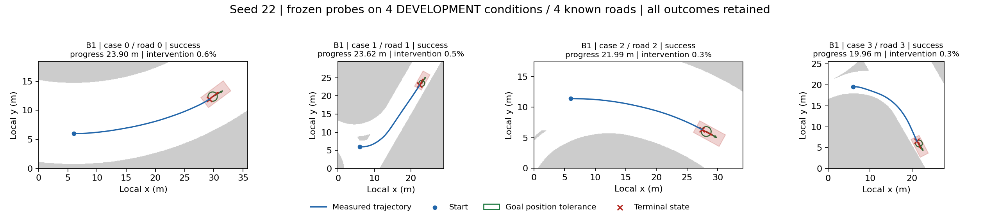

# Shared terminal parking assistance: engineering validation

The frozen B1, H and strong-rule B3 each complete all **four known TRAIN roads**
with zero collision/bounds episodes when using the same explicit physical parking
aid. This is a single-seed development transfer, not research acceptance or proof
of a PPO advantage. Those three frozen transfer policies were not trained under
this wrapper. The separate subsequent B1 course below uses it throughout PPO.

| Method | Success | Controls | Parking overrides | Override fraction |
|---|---:|---:|---:|---:|
| Direct B1 | 4/4 | 1,409 | 6 | 0.43% |
| Hierarchical H | 4/4 | 1,287 | 8 | 0.62% |
| Strong-rule B3 | 4/4 | 1,286 | 8 | 0.62% |

The audit verifies identical parking-helper bytes, numerical calibration, vehicle
limits and goal thresholds across all three methods. Every physical frame is
joined to CARLA and its returned engine control. Every successful terminal frame
satisfies the original position, heading and speed conditions and is **not** an
intervened frame. No pose, velocity, goal or termination criterion is rewritten.
[Complete engineering audit](../reports/native_shared_parking_engineering_20261101.json).

`goal_parking_assist=True` enables `inside_goal_pose_overspeed_brake_v2`.
After actual travel exceeds the existing 0.1 m requirement, the aid may request
full physical braking only if the measured ego is already inside the existing
goal position/heading gates and still exceeds the existing goal speed. Steering
is unchanged. It releases control once speed is low enough; the next ordinary
policy/controller command is physically executed before the unchanged success
gate can accept the episode. All overrides and unassisted proposals are logged.
The option is shared by H, H0, B1, B2 and B3 and defaults to disabled, preserving
historical serialized configurations and signatures.

The first implementation, v1, mistakenly kept intervening after the car was
already parked. The existing `allowed_success=not intervention` guard therefore
blocked success. That run is retained: 1/4 success, three deadlines, 3,021 physical
controls. Its prepared H counterpart was abandoned before any lifecycle and the
launcher now rejects that marker. V2 changes the assistance release condition;
the original success guard remains unchanged. A regression test executes the
intervened braking frame and then the unassisted successful terminal frame.

This engineering result must stay separate from learning results. The preceding
unassisted B1 reflection fit was 3/4 with one bounds failure. A separately learned
177-parameter acceleration head passed its offline overspeed screen, but actual
deployment was only 2/4: it fixed one failure while introducing others. Those
failed models and data remain preserved. Earlier real PPO completed 10,240 new
physical training controls and 320 verified Adam steps but also remained 2/4.
Neither the failed neural fits nor this shared assistance establish added PPO
value. H also transfers from legacy async delivery to the validated synchronous
interface; its numerical gains are unchanged.

The B1 transfer uses model `72d465ab…`, with 30,720 actual PPO controls in its
lineage and separately disclosed supervised pose/reflection fits. H uses model
`c46da0e2…`, with 20,579 controls in its independent training lineage. Their
different histories mean this small transfer is **not** a budget-matched
hierarchical-advantage comparison. B3 performs no learned-policy updates.

All 7,003 controls across the three v2 arms and failed v1 run are included in the
engineering audit; 3,982 belong to v2. The same four conditions are reused for
development, not counted as twelve new conditions. No final set is activated.
Five independently trained healthy baselines, meaningful added PPO value,
explainable collaboration gains, remaining fair ablations and 120 new final
conditions are still required. A formal comparison must train related methods
with the shared wrapper fixed throughout training.

```powershell
python -m pytest tests/test_parking_assist.py -q
python scripts/analyze_native_shared_parking.py --output FRESH_ENGINEERING_AUDIT.json
```

The audit command requires the corresponding preserved run inputs. Existing
registered lifecycles must not be launched again.

The [development prerelease](https://github.com/Leo-7GOAT/Intelligent-driving-system/releases/tag/v0.2.0-dev.20261101-shared-parking)
contains all five capsules, including the failed v1 and actual-PPO runs.
An independent checkout at `ba7b3cfc393b3bc7cec26d6eaa9b0a81a2dd3a6d`
downloaded them without authentication and verified **2,816 files, 18,936 physical
control records and four byte-identical figures**. The engineering report rebuilt
exactly. No additional controls or optimizer updates were performed by this
reconstruction. All 19 remote asset digests also match the uploaded bytes.
[Public reconstruction](../reports/native_shared_parking_public_verification_20261101.json),
[remote assets and Linux CI](../reports/native_shared_parking_public_release_assets_20261101.json).

The same independent checkout then prepared a new owned CARLA lifecycle from
the downloaded B1 model, selecting original TRAIN case 0 before launch. It
succeeded in **356 real controls with three parking overrides**. Every action
reconstructs bit-exactly from the measured history, every engine control matches,
and the final frame satisfies the unchanged goal gates without intervention.
The owned server stopped normally. Model and normalizer bytes remain unchanged.
This adds one reproduction episode, not a new training seed or final condition.
[Physical replay receipt](../reports/native_shared_parking_public_CARLA_replay_20261101.json).

From a fresh checkout with the README dependencies installed:

```powershell
python scripts/reproduce_shared_parking_release.py --recipe protocols/public_native_shared_parking_20261101.json --output runs/shared_parking_public_reproduction
$parent = 'runs/shared_parking_public_reproduction/B1_rebuild/asset/20261101T104233573082Z_native_shared_parking_v2_B1'
python scripts/prepare_published_native_replay.py --batch $parent --method B1 --output runs/my_public_B1_replay --case 0
./scripts/run_registered_native.ps1 -Batch runs/my_public_B1_replay -Kind learning -ActivateQueued -UseCurrentGuard -Python .venv/Scripts/python.exe -CarlaPython .carla-python37/runtime/python.exe
python scripts/audit_native_method_endpoint.py --batch runs/my_public_B1_replay --method B1
$env:NAVSTACK_AUDIT_SOURCE_ROOT = (Resolve-Path runs/my_public_B1_replay/source).Path
python scripts/audit_native_policy_inference.py --batch runs/my_public_B1_replay --method B1 --output runs/my_public_B1_replay/B1/measured_start_inference.json
Remove-Item Env:NAVSTACK_AUDIT_SOURCE_ROOT
python scripts/audit_native_flat_sequence.py --batch runs/my_public_B1_replay --output runs/my_public_B1_replay/B1/whole_sequence_inference.json
python scripts/analyze_public_native_replay.py --batch runs/my_public_B1_replay --output runs/my_public_B1_replay/verification.json
```

The physical commands require the existing CARLA 0.9.15 installation and the
isolated client described in the README. Each output directory must be new.
The release tag remains fixed at `77a136477cfe2a2e215aa797efdcb4be30de11f2`;
its frozen capsule source is `2794b00236319aedbb2ed801f934b61524e2aae4`.
Use subsequent source `ba7b3cf` or newer for CPU reproduction: it fixes the
contiguous matrix layout of two rejected experimental policy classes so their
strict numerical tests also pass on Linux. Released B1/H models use neither class.

## Actual PPO with the wrapper fixed

The subsequent seed22 course uses unchanged parking v2 and synchronous delivery
throughout **10,240 actual CARLA training controls**. Saved Adam state proves
**318 new updates in every one of 35 parameter states**; the existing KL stop
accounts for two fewer updates than the unrestricted 320. Actor and critic both
change. Observation mean, variance and count remain exact; no labels, auxiliary
updates or exploration reset are added. The final predeclared endpoint passes
the unchanged basic gate: **4/4 successes, zero collision/bounds**.

| Known TRAIN case | Endpoint controls | Parking overrides | Outcome |
|---|---:|---:|---|
| 0 | 349 | 2 | Success |
| 1 | 429 | 2 | Success |
| 2 | 320 | 1 | Success |
| 3 | 301 | 1 | Success |

Every one of the **11,639** training/evaluation controls is joined to its measured
CARLA frame and confirmed engine control. The exact frozen helper is reconstructed
for all **10,240 training controls** (41 parking overrides) and all 1,399 endpoint
controls (six overrides). All 1,399 endpoint policy actions reconstruct bit-exactly
from measured history. Training retains **26 successes, three bounds failures and
the budget-truncated 30th episode**. It takes 856.10 seconds before endpoint
evaluation. Total inherited PPO lineage is 40,960 controls; this is not the total
project development cost. The separately executed public replay costs 356 controls.

The frozen starting model was already 4/4 with the same assistance. This course
therefore establishes **basic capability retention under real PPO updates**,
without demonstrating added PPO value. It is one warm-started policy, not five
independent healthy baselines or a full-task result. Final model SHA256 is
`29efb9c3567c347a194717715570bbe4573699a8af72383e1bf349bd3692c753`.
[Full learning/frame/latency audit](../reports/native_B1_shared_parking_PPO_20261101.json),
[whole-sequence action audit](../reports/native_B1_shared_parking_PPO_whole_sequence_20261101.json),
[prospective registration](../reports/native_B1_shared_parking_PPO_registration_20261101.json).



Synchronous execution does not establish real-time operation. Per-case decision
cycle P95 is 0.085/0.275/0.067/0.193 seconds against a 0.05-second period;
over-period fractions are 33.8%/74.1%/26.9%/63.5%. The audit includes P99, maximum,
control-cycle timing and success-conditioned travel time for every case.

The registered next diagnostic evaluates this frozen endpoint on **all twelve
original known curve/static-obstacle/crossing-walker conditions**, with zero new
PPO updates. It does not waive the five-seed gates for formal full-task training
or activate final confirmation conditions. Its output is pending until the new
owned lifecycle and audits finish.
