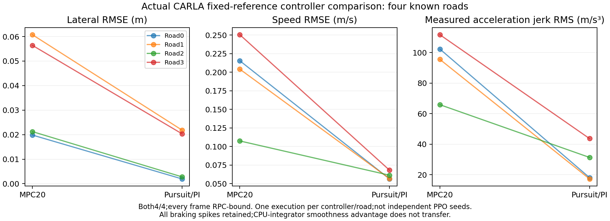

# Completed development diagnostics,31October

The fixed learner-reward-unit B1 hypothesis failed. After20,480actual CARLA
training controls and208Adam steps,the frozen policy completes2/12known
conditions:five bounds failures,one collision and four deadlines. The matched
KL control completes4/12with three unsafe episodes. Scaling all learner rewards
by.05did not improve driving;physical rewards and acceptance gates never changed.
All27,897training/evaluation controls are frame-audited,and all12initial policy
actions reproduce exactly. [Endpoint receipt](native_B1_fixed_reward_units_endpoint_20261031.json).

The fixed496-view teacher-training counterfactual finds zero action change from
statistics alone at10kand20k;the observation moments remain frozen. Updated
weights increase teacher action MSE. This excludes normalization drift for this
profile,without proving a sole cause or treating imitation error as driving
performance. [Final factorial](native_B1_fixed_units_normalization_final_20261031.json).

The separate actual CARLA controller pair is complete,with identical calibration,
398frozen source-file hashes and all eight reference arrays. Both controllers
complete4/4known roads,without collision or road-probe misses. Every saved demand
and measurement is bound to the corresponding raw bridge RPC frame.

| Route-mean metric | MPC20 | Pursuit/PI |
|---|---:|---:|
| Lateral RMSE,m | .03956 | .01172 |
| Speed RMSE,m/s | .19444 | .06072 |
| Measured acceleration jerk RMS,m/s³ | 93.879 | 27.571 |
| Full control-cycle P95,ms | 5.753 | 3.600 |
| Audited physical controls | 1904 | 1907 |

The lightweight MPC smoothness advantage does not transfer to these native
probes. Braking spikes remain in every calculation,including terminal braking;
the shared adapter's measured acceleration can exceed the nominal command
limits. This is a remaining plant/adapter mismatch,not evidence of real-time
deployment,neural learning,independent repetitions or uniform MPC superiority.
The main method still uses MPC. [Complete receipt](native_fixed_reference_controllers_complete_20261031.json).

The earlier native MPC execution completed1905controls/4cases but its guard
rejected a missing worker allowlist entry. The failed supervision and all raw
frames remain;they are audited separately and excluded from the repaired pair's
scores. The guard now checks the actual Python script operand,also rejecting
allowed names hidden in other arguments. Total native control-study consumption
including this failed lifecycle is5716controls.

The [native control archive](https://github.com/Leo-7GOAT/Intelligent-driving-system/releases/download/v0.2.0-dev.20261022/native_fixed_reference_controllers_20261031_repro.zip)
contains all three runs,1297files,raw RPC streams,calibration,references and
unchanged frozen sources. It is7,334,799bytes,SHA256
`d99c88c32f6406d954557403a7a2cf75fa84e6639d3f4c99f64ab9435919f23f`.
Download without authentication and verify the hash before extraction. From the
repository,run`analyze_native_control.py --batch EXTRACTED_RUN`for each run,
then`compare_native_control.py --baseline EXTRACTED_MPC --candidate EXTRACTED_PURSUIT`.
`plot_native_fixed_reference_comparison.py`rebuilds the paired figure from both
audited runs. All three scripts are in`scripts/`.

The B1 model/raw archive is also public in six transfer parts beside its
[manifest](https://github.com/Leo-7GOAT/Intelligent-driving-system/releases/download/v0.2.0-dev.20261022/native_B1_fixed_reward_units_20261031_repro.zip.parts.json).
Its43,449,446bytes/480files assemble to SHA256
`8678d1e3f9d7d13fce8639a00956d11b8230935dc5dd232acfc01f03046272d5`.
Use`native_asset_parts.py join`and`reproduce_native_asset.py`as documented in
the model card. Public download,exact reassembly and independent model/raw/figure
reconstruction have passed. The independent native-controller reconstruction
also reproduces all5716frames,all three metric reports and the paired PNG.
[Executed receipts](completed_native_public_reproduction_20261031.json).

A fresh matched B1collection-length test is prepared:320→1280actions per
rollout,same20,480physical-control budget,320mini-batch,epochs,learning rate,
KL,exploration,initial tensors/optimizer/RNG/normalizer/config and reward units.
The failed control's first episode ends at401controls,after its first320-step
update;longer collection tests observing full terminal feedback before updating.
It is a bounded development hypothesis,not an adopted improvement or extra seed.
[Initialization proof](native_B1_rollout1280_preparation_20261031.json).

Hfrozen reevaluation has completed9/12,all core families3/4,zero unsafe;the longer-collection B1is actually training. H0training,seed22PPO and train36/validation24phases follow through verified owned-process queues. See the later exact-corner report for the complete Hdiagnosis. Healthy B1,five independent trained seeds,the120-condition fresh final
test and the original success/safety/advantage gates remain unmet.
